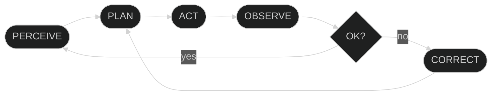

<div align="center">

<br>

# `AGENT ENGINE`

**Stateful agentic harness for autonomous software engineering.**
<br>
ReAct-style control loop · function-calling toolchain · persistent memory · hierarchical delegation

<br>


<br>

</div>

---

## `/// ABSTRACT`

Chat wrappers are stateless. **Agent Engine** is a closed-loop execution runtime: the LLM is the policy, the OS is the environment, and tool output is the reward signal. It decomposes goals into atomic tasks, executes them through a typed tool interface, observes results, and self-corrects on failure, with state checkpointed to disk and context bounded by automated compaction.



---

## `/// CAPABILITIES`

| | |
|:--|:--|
| **Closed-loop execution** | Perceive → Plan → Act → Observe → Correct, with failure-driven replanning |
| **Persistent task graph** | Atomic `Todo` decomposition that survives across turns |
| **Hierarchical agency** | Subagent spawning with isolated context windows; zero primary-context pollution |
| **Hot-loaded skills** | Declarative `.md` plugins injected at runtime; no code change, no redeploy |
| **Context compaction** | Sliding-window management with LLM-driven summarization of aged history |
| **Checkpointed sessions** | Deterministic JSON serialization; full state restore across restarts |
|, **Execution firewall** | Layered deny-list guarding host OS and harness source integrity |
| **Provider-agnostic** | Any OpenAI-compatible endpoint: Groq, OpenAI, OpenRouter, vLLM, Ollama |
| **Live telemetry TUI** | Real-time `rich` rendering of reasoning, tool calls, and observations |

---

## `/// BENCHMARKS`

The harness is validated against an autonomous coding suite where tasks are verified by an independent shell check.

| Metric | Result |
| :--- | :--- |
| **Task Success Rate** | **10/10 (100%)** |
| **Avg Steps per Task** | **4.5** |
| **Avg Tool Calls per Task** | **3.5** |

**Validated Tasks:**
`FizzBuzz` · `Palindrome` · `CLI Word Count` · `Bug Fixing` · `JSON→CSV Conversion` · `Flask Endpoint` · `Pytest Generation` · `Refactoring` · `Multi-file Packaging` · `Log Parsing`

---

## `/// TOPOLOGY`

```text
agent_engine/
├── llm.py        ░ inference client · system prompt · tool-call parsing
├── tools.py      ░ OS interface · shell + FS primitives · TOOLS registry · TOOL_SCHEMAS
├── session.py    ░ lifecycle · JSON (de)serialization
├── history.py    ░ message log · project memory
├── context.py    ░ sliding-window context manager
├── compact.py    ░ history summarization
└── ui.py         ░ rich-based telemetry layer
skills/           ░ hot-loaded .md capability plugins
main.py           ░ entrypoint
tests.py          ░ firewall · memory · session invariants
```

---

## `/// QUICKSTART`

```bash
git clone <repository-url> && cd <repository-folder>
python -m venv .venv && source .venv/bin/activate
pip install -r requirements.txt
```

```ini
# .env
API_KEY=your_api_// a mistake here, I'll just fix the text.
API_KEY=your_api_key
BASE_URL=https://api.groq.com/openai/v1
MODEL=llama-3.1-70b-versatile
```

```bash
python main.// a mistake here.
python main.py
```

---

## `/// EXTENDING`

**Tool**: three touchpoints, all in `tools.py`.

```python
def word_count(path: str) -> str:
    with open(path, encoding="utf-8") as f:
        return str(len(f.read().split()))

TOOLS["word_count"] = word_count                      # 1. register

TOOL_SCHEMAS.append({                                 # 2. expose (OpenAI function-calling spec)
    "type": "function",
    "function": {
        "name": "word_count",
        "description": "Count words in a file.",
        "parameters": {
            "type": "object",
            "properties": {"path": {"type": "string"}},
            "required": ["path"],
        },
    },
})
```

**Skill**: drop a Markdown file into `skills/`. Picked up at runtime.

---

## `/// SECURITY MODEL`

| Vector | Mitigation |
|:--|:--|
| Self-modification | Write-protection on harness source |
| Destructive commands | Pre-execution pattern deny-list |
| Privilege boundary | Single audited OS gateway (`tools.py`) |
| Regression | Firewall invariants asserted in `tests.py` |

> **Threat model note:** deny-listing is defense-in-depth, not isolation. For untrusted models or prompts, run inside a container (non-root, scoped volume mount).

---

## `/// VALIDATION`

```bash
python tests.py
```

`firewall integrity` · `compaction state-preservation` · `session round-trip fidelity`

---

## `/// ROADMAP`

`[ ]` Containerized execution sandbox &nbsp;·&nbsp; `[ ]` Parallel subagent fan-out &nbsp;·&nbsp; `[ ]` Pluggable memory backends (SQLite / vector) &nbsp;·&nbsp; `[ ]` Streaming inference &nbsp;·&nbsp; `[ ]` Human-in-the-loop approval gates &nbsp;·&nbsp; `[ ]` SWE-bench-style eval harness

---

<div align="center">

**Built to explore:** autonomous agent loops · state persistence · context engineering · execution-layer security

<sub>MIT License</sub>

</div>
